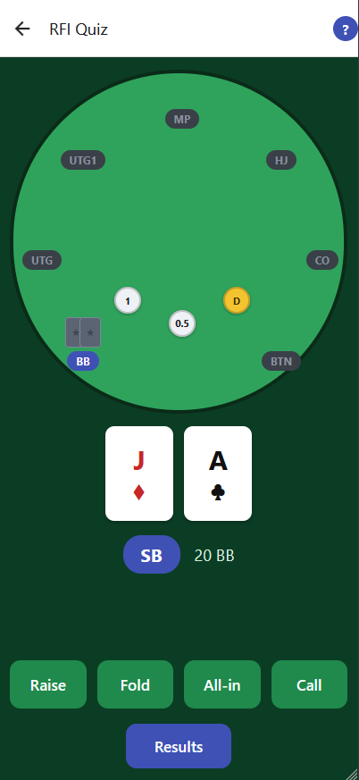

# Poker Trainer

A quiz-style app for practicing preflop poker decisions, built with Expo (React Native + TypeScript).

The first quiz covers **RFI (Raise First In)**: you're dealt a hand at a 20BB stack, and you pick the right action for your position. **Vs RFI** and **Vs 3bet** quizzes are in progress.

<p align="center">
  
</p>

## Features

- **Three practice modes**
  - **Advance Seat**: move around the table one seat per hand
  - **Seat Lock**: drill a single position
  - **Random Spot**: get a random position every hand
- **Instant feedback** after each decision, including mixed strategies (e.g. fold 50% / call 50%)
- **Built-in help** that explains each quiz and how to read the ranges
- **Progress saved** on your device

## Tech Stack

- Expo (React Native + TypeScript)
- React Navigation
- Range data bundled as JSON
- AsyncStorage for local progress

## Getting Started

```bash
npm install
npm start
```

Then press `i` for iOS, `a` for Android, or `w` for web, or run `npm run ios`, `npm run android` or `npm run web`.